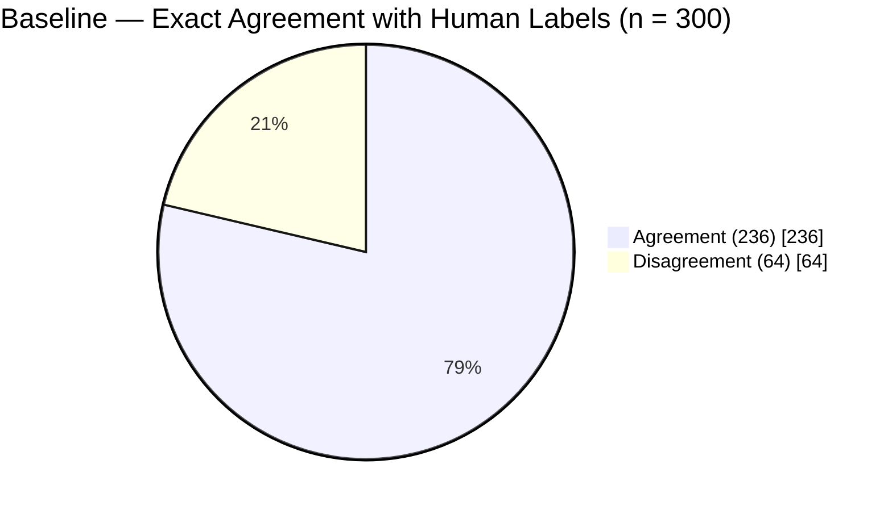
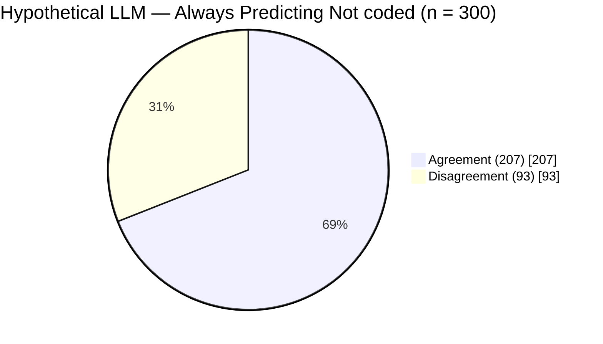

# 01. Accuracy and Cohen's κ

This note uses actual data from my `coding-manual-ablation` study.

Let's start with the main point.

- **Accuracy**: How often did the LLM give the same label as the human coder?
- **Cohen's κ (kappa)**: How high is the observed agreement after accounting for the agreement expected from how often each coder uses each category?

Both measure agreement. The difference is that **κ also accounts for the category distributions**.

## 1. Let's start with accuracy

In my study, the LLM coded 300 utterances that had already been coded by humans.

Here are the baseline results.

**Baseline · 300 utterances**

- **Exact agreement: 78.7%**
- Agreement: 236
- Disagreement: 64

The calculation is simple.

$$
\text{Accuracy}=\frac{\text{Number of agreements}}{\text{Total number of utterances}}
$$

$$
=\frac{236}{300}=0.7867\;\;(78.7\%)
$$

In other words, the LLM assigned the same label as the human coder to 236 of the 300 utterances.

Strictly speaking, accuracy in my study means **exact agreement with the human reference labels**. It does not mean that those human labels are necessarily an absolute ground truth.

## 2. But there is a problem with accuracy

In my data, humans labeled **207 of the 300 utterances** as `Not coded`. That's **69%**.

Now, imagine a hypothetical LLM.

This LLM does not even read the utterances. It always answers `Not coded`.

What would happen?

**Hypothetical experiment · Always predicting `Not coded`**

- **Exact agreement: 69.0%**
- Agreement: 207
- Disagreement: 93

Even without considering the content of the utterances, this model would achieve 69% accuracy.

That's because one category is overwhelmingly common in the data.

With data like this, accuracy alone makes it difficult to judge how meaningfully the LLM agrees with human coding.

This is where Cohen's κ becomes useful.

## 3. What does Cohen's κ account for?

κ uses two quantities.

- **$P_o$**: Observed agreement
- **$P_e$**: Expected agreement calculated from how often the two coders use each category

Here is the formula.

$$
\kappa=\frac{P_o-P_e}{1-P_e}
$$

Before focusing on the formula, let's understand the logic.

These are the actual baseline values from my study.

| Measure | Value |
| --- | ---: |
| Observed agreement $P_o$ | 0.7867 |
| Expected agreement $P_e$ | 0.4551 |
| Cohen's κ | 0.6085 |

We can interpret this in three steps.

**First.** The observed agreement was 78.67%.

**Second.** If the human and LLM labels were paired independently while keeping each coder's category proportions fixed, we would expect about 45.51% agreement.

**Expected agreement does not mean the LLM actually answered randomly.** It is a mathematical reference value calculated from the category proportions.

**Third.** Subtract expected agreement from observed agreement. Then divide by the remaining range above expected agreement.

$$
\kappa=\frac{0.7867-0.4551}{1-0.4551}
$$

$$
\approx\frac{0.3316}{0.5449}\approx0.6085
$$

Using the original values before rounding gives the κ reported in the study.

This means that **the observed agreement accounts for about 60.85% of the possible agreement above the expected level**.

It does **not** mean that the LLM got 60.85% of the utterances correct.

## 4. What would κ be for the hypothetical LLM?

Let's return to the model that always predicts `Not coded`.

- Exact agreement $P_o$ = 0.69
- Expected agreement $P_e$ = 0.69
- Cohen's κ = 0

This hypothetical model always predicts a single category. As a result, its observed agreement equals the agreement expected from the category proportions.

| | Actual baseline | Hypothetical LLM |
| --- | ---: | ---: |
| Exact agreement | **78.7%** | **69.0%** |
| Cohen's κ | **0.6085** | **0** |
| Classification | Labels vary by utterance | Always predicts `Not coded` |

This comparison shows **why accuracy and κ give different information when the data have a strong class imbalance**.

But κ does not solve every problem. It is also affected by category distributions. And it does not tell us how well the model performs on rare categories.

## 5. What I want to understand from this note

**Accuracy measures how often the two coders agree.**

**Cohen's κ measures agreement while accounting for the agreement expected from the category distributions.**

This leads naturally to the next question.

> How exactly was the expected agreement of $P_e=0.4551$ calculated in my study?

In the next note, I'll calculate $P_e$ directly using the human and LLM label counts for all seven categories.

---

**Data source**: [coding-manual-ablation — Main scoring record](https://github.com/geekinthegit/coding-manual-ablation/blob/main/reports/main-scoring-record-2026-09-24.md), §§8 and 11. The study values come from the actual baseline results. The model that always predicts `Not coded` is a **hypothetical example** for learning purposes.
