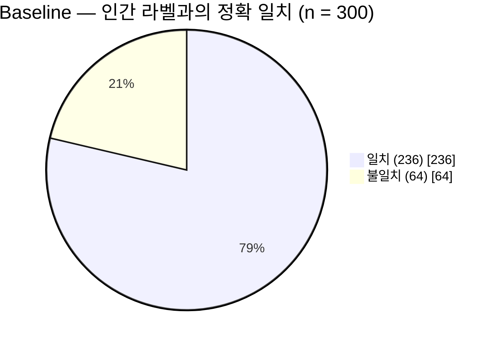
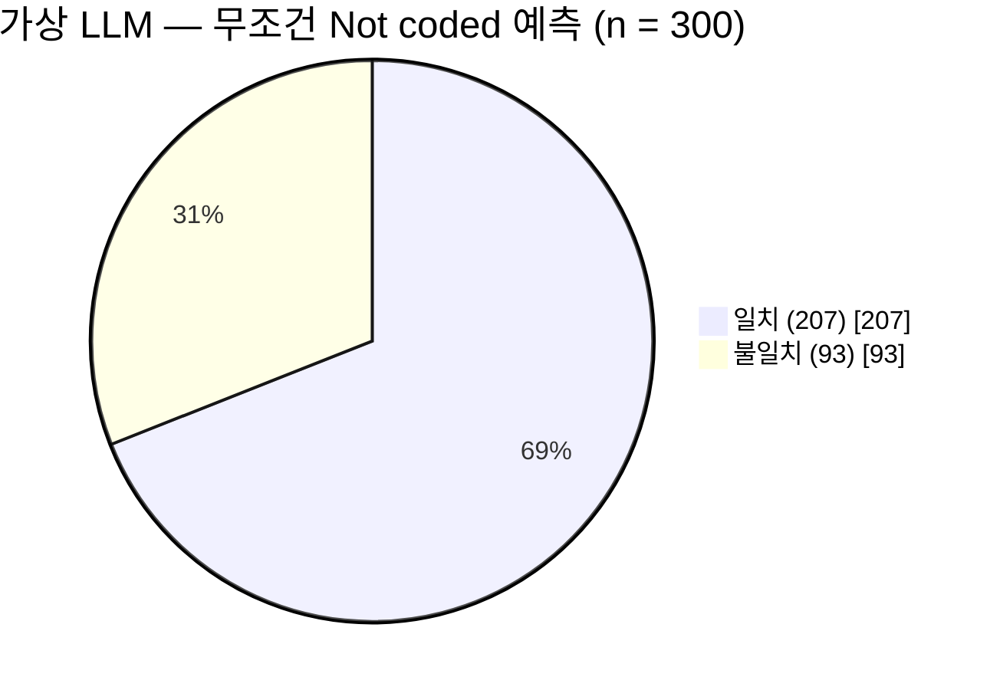

# 01. 정확도(Accuracy)와 Cohen's κ

이번 노트에서는 내 `coding-manual-ablation` 연구의 실제 데이터를 사용한다.

먼저 핵심부터.

- **정확도(Accuracy)**: LLM이 인간 코더와 얼마나 자주 같은 답을 냈는가?
- **Cohen's κ(카파)**: 두 코더가 각 범주를 사용하는 비율에서 기대되는 일치를 고려하면 실제 일치도는 얼마나 높은가?

둘 다 일치도를 측정하지만, **κ는 범주별 분포까지 고려한다는 차이**가 있다.

## 1. 정확도(Accuracy)부터

내 연구에서는 인간이 이미 코딩한 300개 발화를 LLM도 코딩했다.

Baseline의 결과는 다음과 같다.

**Baseline · 300개 발화**

- **정확 일치율: 78.7%**
- 일치: 236개
- 불일치: 64개

계산은 간단하다.

$$
\text{Accuracy}=\frac{\text{일치한 개수}}{\text{전체 개수}}
$$

$$
=\frac{236}{300}=0.7867\;\;(78.7\%)
$$

즉, LLM이 인간 라벨과 300개 중 236개를 동일하게 분류했다.

여기서 엄밀히 말하면 내 연구의 정확도는 **인간 라벨을 기준으로 한 정확 일치율(exact agreement)**이다. 인간 라벨 자체가 반드시 절대적인 정답이라는 뜻은 아니다.

## 2. 그런데 정확도에는 문제가 있다

내 데이터에서 인간이 `Not coded`로 분류한 발화는 **300개 중 207개**다. 전체의 **69%**다.

자, 가상의 LLM을 하나 생각해 보자.

이 LLM은 발화 내용을 아예 읽지도 않고 무조건 `Not coded`라고 답한다.

그러면 어떻게 될까?

**가상 실험 · 무조건 `Not coded`만 출력**

- **정확 일치율: 69.0%**
- 일치: 207개
- 불일치: 93개

발화 내용을 전혀 고려하지 않아도 정확도가 69%나 나온다.

이유는 한 범주가 데이터에서 압도적으로 많기 때문이다.

그래서 이런 데이터에서는 정확도만 보면 LLM이 얼마나 의미 있게 인간 코딩과 일치하는지 판단하기 어렵다.

바로 여기서 Cohen's κ가 유용하다.

## 3. Cohen's κ는 무엇을 추가로 고려할까?

κ는 다음 두 가지를 사용한다.

- **$P_o$**: 실제 관찰된 일치율(Observed agreement)
- **$P_e$**: 두 코더의 범주별 사용 비율에서 계산한 기대 일치율(Expected agreement)

공식은 다음과 같다.

$$
\kappa=\frac{P_o-P_e}{1-P_e}
$$

처음에는 수식을 보지 말고 논리부터 이해해 보자.

내 Baseline의 실제 수치는 다음과 같다.

| 항목 | 값 |
| --- | ---: |
| 실제 일치율 $P_o$ | 0.7867 |
| 기대 일치율 $P_e$ | 0.4551 |
| Cohen's κ | 0.6085 |

이것을 세 단계로 해석할 수 있다.

**첫째.** 실제로는 78.67% 일치했다.

**둘째.** 인간 코더와 LLM의 범주별 사용 비율을 유지한 채, 두 라벨이 서로 독립적으로 대응된다고 가정하면 약 45.51%의 일치가 기대된다.

여기서 **기대 일치율은 실제 LLM이 무작위로 대답했다는 뜻이 아니다.** 범주별 비율로 계산한 수학적 기준값이다.

**셋째.** 실제 일치율에서 기대 일치율을 빼고, 기대 일치율을 넘어설 수 있는 나머지 범위로 나눈다.

$$
\kappa=\frac{0.7867-0.4551}{1-0.4551}
$$

$$
\approx\frac{0.3316}{0.5449}\approx0.6085
$$

소수점 반올림 전의 원래 값으로 계산하면 보고서의 κ가 나온다.

즉, **기대 일치 수준을 넘어설 수 있는 범위 중 약 60.85%에 해당하는 일치 수준을 달성했다**는 해석이 가능하다.

다만 이것을 **'60.85%를 정확히 맞혔다'**는 뜻으로 이해하면 안 된다.

## 4. 아까 그 가상 LLM은 κ가 얼마일까?

무조건 `Not coded`라고 답했던 LLM을 다시 보자.

- 정확 일치율 $P_o$ = 0.69
- 기대 일치율 $P_e$ = 0.69
- Cohen's κ = 0

왜냐하면 이 가상 모델은 항상 한 범주만 출력하므로, 실제 일치율이 범주별 분포에서 기대되는 일치율과 같기 때문이다.

| | 실제 Baseline | 가상 LLM |
| --- | ---: | ---: |
| 정확 일치율 | **78.7%** | **69.0%** |
| Cohen's κ | **0.6085** | **0** |
| 분류 방식 | 발화에 따라 분류 | 무조건 `Not coded` |

이 비교로 **범주 불균형(class imbalance)이 큰 자료에서 정확도와 κ가 왜 다른 정보를 주는지** 이해할 수 있다.

그렇다고 κ가 모든 문제를 해결하는 것은 아니다. κ도 범주별 분포에 영향을 받는다. 또 희소 범주의 성능을 별도로 알려주지는 않는다.

## 5. 이번에 이해할 핵심

**Accuracy는 얼마나 많이 일치했는지를 측정한다.**

**Cohen's κ는 범주별 분포로부터 기대되는 일치를 고려해서 일치도를 측정한다.**

다음 질문은 자연스럽다.

> 내 연구에서 기대 일치율 $P_e=0.4551$은 도대체 어떻게 계산됐을까?

다음 노트에서는 실제 7개 범주의 인간 라벨 수와 LLM 라벨 수를 사용해 $P_e$를 직접 계산한다.

---

**자료 출처**: [coding-manual-ablation — Main scoring record](https://github.com/geekinthegit/coding-manual-ablation/blob/main/reports/main-scoring-record-2026-09-24.md), §8 및 §11. 실제 연구의 수치는 Baseline 결과에서 가져왔다. 무조건 `Not coded`만 출력하는 모델은 개념 학습을 위한 **가상 예시**다.
